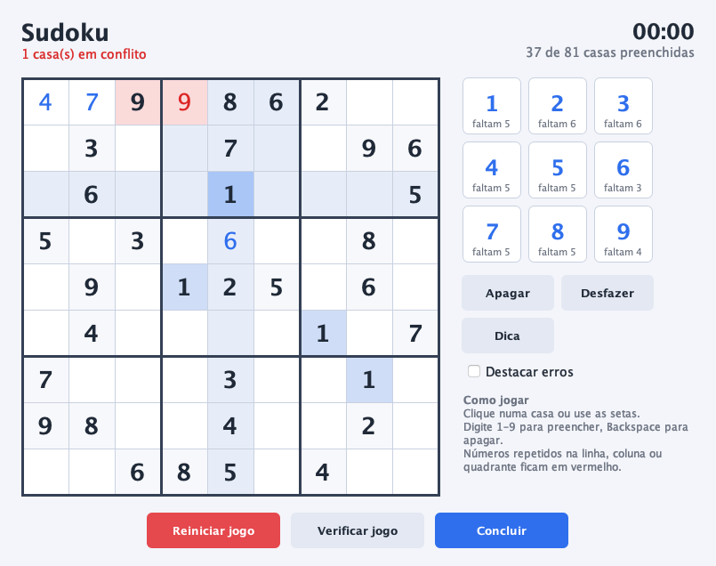

# Sudoku em Java (Swing)

Projeto de Sudoku do desafio da DIO. A versão de console fica em `Main`. A interface gráfica fica em `UIMain` e é a parte melhorada aqui, a partir da branch `ui` do repositório original ([digitalinnovationone/sudoku](https://github.com/digitalinnovationone/sudoku)).



## Como executar

Requer JDK 21 ou superior.

```bash
./run.sh
```

Sem argumentos, o jogo abre com um tabuleiro padrão. Para usar outro tabuleiro, passe as 81 posições no formato `coluna,linha;valor,fixo`:

```bash
./run.sh "0,0;4,false" "1,0;7,false" "2,0;9,true" ...
```

Na IDE, rode a classe `br.com.dio.UIMain` com os argumentos do desafio em *Program arguments*. O tabuleiro do desafio é o mesmo que o jogo usa como padrão e está na constante `GameConfigParser.DEFAULT_GAME`.

## Como jogar

| Ação | Mouse | Teclado |
|---|---|---|
| Selecionar casa | clique na casa | setas ou W A S D |
| Preencher | teclado numérico da lateral | `1` a `9` |
| Apagar | botão **Apagar** | `Backspace`, `Delete` ou `0` |
| Desfazer | botão **Desfazer** | `Ctrl+Z` (`Cmd+Z` no macOS) |
| Dica | botão **Dica** | `H` |

## O que foi melhorado

### Visual
- **Tabuleiro desenhado do zero** (`ui/custom/board/SudokuBoardPanel`) no lugar dos 81 `JTextField` em `FlowLayout`: a grade fica alinhada, com linhas finas entre as casas e linhas grossas separando os quadrantes 3x3.
- **Números fixos legíveis.** Antes eles usavam `setEnabled(false)` e apareciam em cinza claro. Agora são escuros e em negrito, sobre um fundo levemente diferente. Os números do jogador ficam em azul e os das dicas em verde.
- **Destaques de leitura.** Ao selecionar uma casa, a linha, a coluna e o quadrante dela ficam destacados, assim como os outros números iguais ao dela.
- **Tema centralizado** (`ui/custom/theme/Theme`) com as cores e fontes num só lugar.
- **Botões planos com cantos arredondados** (`FlatButton`), com a mesma aparência em Windows, macOS e Linux. Os botões originais (`ResetButton`, `CheckGameStatusButton`, `FinishGameButton`) passaram a estender `FlatButton`.
- **Cabeçalho** com título, status do jogo em tempo real, cronômetro e progresso (casas preenchidas de 81).

### Jogabilidade
- **Conflitos em tempo real.** Um número repetido na mesma linha, coluna ou quadrante fica em vermelho. Isso segue só as regras do Sudoku e não revela a solução.
- **Opção "Destacar erros"**, que marca em vermelho os números diferentes da solução.
- **Teclado numérico na lateral.** Cada botão mostra quantas vezes o número ainda falta no tabuleiro e é desativado quando o número está completo.
- **Desfazer**, com histórico de jogadas.
- **Dica.** Preenche a casa selecionada com o valor correto. Se ela já estiver certa, preenche a primeira casa vazia ou errada.
- **Fim de jogo automático.** Quando o tabuleiro fica correto, o cronômetro para, o tabuleiro é bloqueado e uma mensagem mostra o tempo e o número de dicas usadas. **Reiniciar jogo** começa de novo.
- **Mensagens mais úteis.** "Concluir" diz quantas casas faltam ou quantos números estão errados, e "Verificar jogo" informa o progresso e a quantidade de erros.

### Correções e robustez
- A interface é criada na thread do Swing (`SwingUtilities.invokeLater`).
- A janela era exibida (`setVisible(true)`) antes de receber o painel. Agora ela é montada, dimensionada com `pack()` e só depois exibida. No macOS o tamanho é recalculado depois de exibida, para o tabuleiro não ser cortado.
- **Validação dos argumentos** (`util/GameConfigParser`). Formato inválido, posição repetida ou quantidade diferente de 81 mostram uma mensagem clara, em vez de `NullPointerException`.
- **Tabuleiro padrão.** O jogo abre mesmo sem argumentos.
- `NotifierService` usa `EnumMap` com todos os eventos e ganhou o evento `SPACE_CHANGED`, que atualiza cabeçalho, teclado e tabuleiro a cada jogada.
- Corrigido o erro de digitação "imcompleto".

### Organização do código
- `BoardService` passou a ter toda a regra usada pela tela: alterar/limpar com histórico, desfazer, dica, conflitos, erros, contagens.
- Removidos `NumberText`, `NumberTextLimit` e `SudokuSector`, substituídos pelo novo tabuleiro.
- Novos componentes: `HeaderPanel`, `NumberPadPanel`, `DigitButton`, `FlatButton` e `GameTimer`.
- `run.sh` compila e executa o projeto sem depender de IDE.

## Estrutura

```
src/br/com/dio
├── Main.java                  # versão de console
├── UIMain.java                # versão gráfica
├── model/                     # Board, Space, GameStatusEnum
├── service/                   # BoardService, NotifierService, eventos
├── util/                      # GameConfigParser (argumentos + jogo padrão), BoardTemplate
└── ui/custom
    ├── board/                 # SudokuBoardPanel
    ├── button/                # FlatButton, DigitButton e botões de ação
    ├── frame/                 # MainFrame
    ├── panel/                 # MainPanel, HeaderPanel, NumberPadPanel
    ├── screen/                # MainScreen, GameTimer
    └── theme/                 # Theme
```

## Ideias para próximos passos
- Anotações (números pequenos de rascunho) em cada casa.
- Gerador de tabuleiros com níveis de dificuldade.
- Testes automatizados para `BoardService`.
